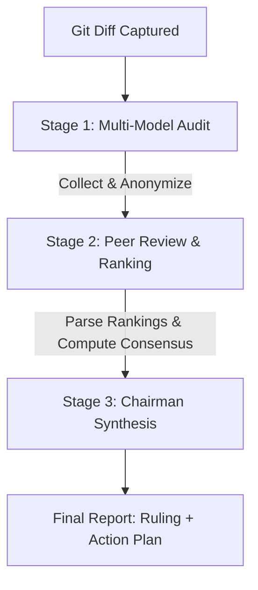

# SW-Council

A standalone, parallel, multi-model consensus software deliberation engine designed as a plug-and-play CLI tool and agent skill. It runs a strict 3-stage deliberation pipeline directly against active workspace modifications (`git diff`) using either OpenRouter, Gemini API, or local Ollama instances, without requiring database logging or complex server-side storage.

---

## 🏗️ Architecture

### Stage 1: Advisor Responses Collection
The engine runs evaluations in parallel across multiple model personas (or separate query instances) to assess the git diff through 8 distinct software development lenses:
1. **Security Lead**: Spotting threat vectors, input validation flaws, and PII leaks.
2. **Performance Lead**: Identifying runtime overhead, CPU/memory bottlenecks, and scale issues.
3. **Developer Experience (DX) Lead**: Reviewing maintainability, clean code patterns, and ease of testing.
4. **Contrarian**: Bluntly pointing out likely breaking points and edge cases.
5. **First Principles Thinker**: Re-evaluating the underlying problem definition and assumptions.
6. **Expansionist**: Spotting missed optimization or feature scale opportunities.
7. **Outsider**: Reviewing with zero contextual bias as a smart generalist.
8. **Executor**: Defining the minimum shippable vertical slice.

### Stage 2: Anonymization & Peer Review
To prevent models from playing favorites or expressing token-based biases, the Stage 1 outputs are anonymized (labeled as `Response A`, `Response B`, etc.) and shuffled. 
- The council models are then queried in parallel to evaluate and rank the anonymized reviews.
- The engine automatically parses the formatted `FINAL RANKING:` sections and computes the aggregate rank average (Borda-count consensus) for each model's feedback.

### Stage 3: The Chairman Synthesis
The Software Council Chairman reads the cascading evaluations, peer reviews, and computed consensus metrics to render the final synthesis:
- **Ruling**: Approve (with conditions) or Reject (needs iteration).
- **Core Justification**: The single most decisive factor behind the ruling.
- **Action Plan**: A clear, 2-3 step actionable list to resolve findings.

---

## 🛠️ CLI Wrappers & Symlinks

Platform-specific executable wrappers are provided to run the Python script seamlessly from any terminal environment:
- **Windows**: `scripts/sw-council.bat`
- **Unix/macOS**: `scripts/sw-council.sh`

---

## 🚦 Verbose Notifications & Step Progress

The tool prints step-by-step progress to `stdout` with descriptive summaries of each milestone:
- 🌀 **Step 1 Started**: `🌀 Step 1: Stage 1 (Advisor Responses Collection) has started...`
- ✅ **Step 1 Completed**: `✅ Step 1 has been completed - successfully collected code audit feedback from [count] separate model personas.`
- 🌀 **Step 2 Started**: `🌀 Step 2: Stage 2 (Peer Review and Ranking) has started...`
- ✅ **Step 2 Completed**: `✅ Step 2 has been completed - peer rankings collected and consensus computed: [rankings].`
- 🌀 **Step 3 Started**: `🌀 Step 3: Stage 3 (Chairman Synthesis) has started...`
- ✅ **Step 3 Completed**: `✅ Step 3 has been completed - chairman has synthesized the final consensus report and generated the action plan.`

---

## ⚙️ Configuration & API Fallbacks

1. **OpenRouter (Primary)**: Uses `OPENROUTER_API_KEY` to run the parallel queries across configured models (e.g. `google/gemini-2.5-flash`, `meta-llama/llama-3.3-70b-instruct`, `deepseek/deepseek-chat`, `qwen/qwen-2.5-72b-instruct`).
2. **Gemini API (Secondary Fallback)**: Automatically falls back to native Gemini APIs if `GEMINI_API_KEY` is present.
3. **Ollama (Local routing & fallback)**: If the requested model is installed locally in Ollama (checked via `/api/tags`), the engine bypasses OpenRouter and queries it directly. If no keys are set, the engine falls back to querying the requested model on local Ollama.
   * **Context Size Handling**: During Stage 2 (Peer Review), the cascading context size is quite large. To prevent `exceed_context_size_error` (HTTP 400 Bad Request) from Ollama, the engine dynamically sets the context window option (`num_ctx`) to **32,768** tokens for all local Ollama requests. Ensure your local machine has sufficient RAM/VRAM allocation to support 32k contexts for the running models.
