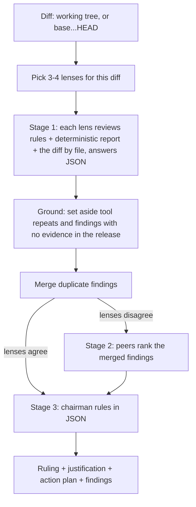

# SW-Council

A multi-model software review council you run from the command line or as an agent skill. It reviews a
git diff in three stages: lenses review, peers rank, and a chairman rules. It uses local Ollama models,
OpenRouter or the Gemini API, and needs no server or database. It is also AOC-QC's scenario-3 release
reviewer (ADR-0009), which reads its JSON output.

## How it works



1. **Lenses per diff.** It picks 3 or 4 of the 8 lenses from what changed: security for auth or input
   code, performance for loops and queries, executor for release files, and so on; the contrarian and
   DX lenses usually make the cut. `--lenses all` or a list overrides this. Lenses whose findings
   developers rarely accept can be dropped in config.
2. **Context, not just the diff.** Each lens gets the rules file (`--rules`), the deterministic report
   (`--report`), and the diff split by file. When the context is tight, the diff is what gets cut,
   never the rules.
3. **Structured output.** Each lens answers JSON findings: file, line, severity, message, suggested fix.
   Duplicates are merged across lenses before anything else. There is no `FINAL RANKING:` prose
   parsing any more.
6. **Grounded findings only.** Before peer review, every lens finding is checked against the diff
   (`council_core.ground_findings`), with no model involved. A finding is set aside, never blocking and
   never shown to the chairman, when it:
   - repeats a deterministic tool finding from `--report` (same file, plus a shared token like a colour
     or CVE id, or a nearby line on the tool rule's topic). Tool findings keep the tool's rule and
     severity: the council can refer to them but not re-raise or escalate them;
   - cites no file, a file not in the diff (ignored folders, build output), or a file the range deletes;
   - cites no line and no quoted `evidence`, a line the diff does not show, a comment or blank line
     without a quote, or a quote that is not in the diff near that line;
   - claims a hard-coded or exposed secret when no cited line assigns a real value (`KEY=` is empty).

   Deleted files are named (`<file-deleted>`) but their old code is not shown to the lenses. The
   chairman's `blocking_finding_ids` must name grounded findings: unknown ids are dropped; a reject that
   names none becomes `approve_with_conditions` (with `ruling_note`) when no grounded finding is left,
   and fails closed (exit 2) when grounded findings exist but none was named.
4. **Lighter peer review.** Peers rank the merged findings list, not each other's essays. The stage is
   skipped when the lenses already agree, so no 32k context is needed for it.
5. **Cache and model routing.** Lens results are cached by diff + rules + lens + model
   (`~/.cache/sw-council`, 14 days, `--no-cache` to bypass). Small fast models take the lenses and
   the strongest takes the chairman. Model ids live in `scripts/sw_council.config.json`.

## Usage

Run from inside the repo to review:

```bash
python scripts/sw_deliberate.py                     # text report; last line COUNCIL_VERDICT: APPROVED|REJECTED
python scripts/sw_deliberate.py --format json       # only the JSON ruling on stdout, progress on stderr
python scripts/sw_deliberate.py --base v1.2.0 --rules aocqc.rules.yaml --report report.json --format json
```

| Flag | Meaning |
| --- | --- |
| `--format text\|json` | Text report (default), or the JSON ruling record |
| `--base REF` | Review `REF...HEAD` (a release range) instead of the working tree |
| `--diff-file PATH` | Review this diff instead of asking git |
| `--rules PATH`, `--report PATH` | Context for the lenses: the rules file and the deterministic run report |
| `--lenses auto\|all\|a,b` | Lens choice; `--max-lenses N` for auto |
| `--peer-review auto\|on\|off` | `auto` skips stage 2 when the lenses agree |
| `--config PATH` | Model ids and settings (also `SW_COUNCIL_CONFIG`) |
| `--lens-model ID` (repeatable), `--chairman-model ID` | Override the config's models |
| `--no-cache` | Neither read nor write the lens cache |

Exit code: `0` approved (or nothing to review), `1` rejected, `2` the ruling could not be read or no lens
answered (fails closed).

### JSON output (`sw-council.ruling/v1`)

```json
{
  "schema": "sw-council.ruling/v1",
  "ruling": "reject",
  "justification": "SQL injection in app/db.py",
  "action_plan": ["Use bound parameters in find()"],
  "findings": [
    {"id": "F1", "file": "app/db.py", "line": 2, "lens": "security", "lenses": ["security", "contrarian"],
     "severity": "high", "blocking": true, "message": "...", "evidence": "the quoted line", "suggested_fix": "..."}
  ],
  "set_aside": [
    {"file": ".env.example", "line": null, "lens": "security", "severity": "critical", "message": "...",
     "reason": "cites no line or quoted text"}
  ],
  "ruling_note": null,
  "lenses": ["security", "contrarian", "dx", "performance"],
  "models": {"lens": {"security": "gemma3:12b"}, "chairman": "gemma4:12b"},
  "stats": {"files": 1, "lenses_answered": 4, "cache_hits": 0, "findings": 1, "set_aside": 1, "peer_review": true}
}
```

`blocking` is true only for findings the chairman names when it rejects. AOC-QC still decides what blocks,
and re-checks grounding itself. `set_aside` findings are advisory at most; `ruling_note` says when the
chairman's ruling was held to the grounded findings.

## Models and providers

`scripts/sw_council.config.json` holds `lens_models` (given to the lenses in turn), `chairman_model`,
`max_lenses`, `peer_review`, `dropped_lenses` and `gemini_default_model`. Prefix an id to pin its provider
and send the id unchanged: `ollama:qwen2.5-coder:latest`, `openrouter:qwen/qwen-2.5-coder-14b-instruct`,
`gemini:gemini-2.5-pro`, or `fake:<name>` for tests. A bare id keeps the automatic routing. That means local
Ollama if the model is installed, then Gemini (`GEMINI_API_KEY`, using the configured Gemini id rather than a
hard-coded one, which fixes the old 404s), then OpenRouter (`OPENROUTER_API_KEY`), then Ollama. Only
`OPENROUTER_API_KEY` and `GEMINI_API_KEY` are read from a `.env` file.

Ollama context (`num_ctx`) is sized per request, up to `SW_COUNCIL_MAX_CTX` and the model's own limit.
`SW_COUNCIL_PROFILE=fast` turns peer review off and caps reply lengths. `SW_COUNCIL_CONCURRENCY`
(default 1) keeps local models from fighting over one GPU.

## Tests

```bash
python -m unittest discover tests      # no models or network: the fake provider answers
```

`fake:` models answer from `SW_COUNCIL_FAKE_RESPONSES`, a JSON file mapping a role (`lens:<id>`, `lens`,
`peer`, `chairman`) to a reply. `SW_COUNCIL_FAKE_LOG` records what each role was sent.

## CLI wrappers

`scripts/sw-council.bat` (Windows) and `scripts/sw-council.sh` (Unix) run the script with your arguments.
